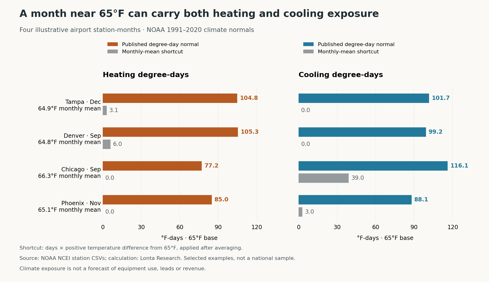

# Lonta Research: NOAA climate thresholds

Compare published heating and cooling degree-day normals with a shortcut based
on monthly mean temperature. This repository contains the data and Python code
behind [Lonta Research's temperature-threshold comparison](https://lonta.io/research/hvac-seasonality/#downloads).
Lonta Research is published by [Lonta AI](https://lonta.io/), a home-services
marketing company. This is company-authored secondary analysis of NOAA data.

At Tampa International, December's 1991–2020 monthly mean normal is 64.9°F.
Thresholding that mean at 65°F gives 3.1 heating degree-days and zero cooling
degree-days. NOAA's published normals for the station-month are 104.8 and 101.7
respectively. The calculations retain different information.



## Run the audit offline

Python 3.10 or newer; no third-party packages required for the data audit:

```sh
git clone https://github.com/artemsedin74/lonta-noaa-climate-thresholds.git
cd lonta-noaa-climate-thresholds
python3 analysis.py --no-chart
python3 -m unittest discover -s tests -v
```

The calculation verifies the 24 raw CSV hashes, twelve unique month keys per
station, units, missing-value sentinels, flags and the four illustrated results.
It writes `station-months.csv` and `analysis.json`. The report's execution time
and Python version describe that particular run; data values should reproduce.
Run `sha256sum -c SHA256SUMS.txt` before regenerating files to verify the released
file bytes. On macOS, use `shasum -a 256 -c SHA256SUMS.txt`.

`companion.ipynb` contains calculation cells and recorded outputs. The chart
already exists as PNG and SVG. To regenerate it, install matplotlib and numpy in
your own environment and run `python3 analysis.py` without `--no-chart`.
The data audit does not install packages or make network requests.

## What is in the data

The grain is one station-month: 24 airport stations × 12 months = 288 rows,
covering 864 published values. The stations were selected for the existing
climate calendar, not sampled randomly from the United States.

| Field group | Meaning |
|---|---|
| `temperature_F` | Published monthly average temperature normal, °F |
| `heating_F_days`, `cooling_F_days` | Published NOAA degree-day normals, 65°F base |
| `proxy_*` | Days × the positive difference between the rounded monthly mean and 65°F |
| `*_measurement_flag` | NOAA measurement flag; `X` means nonzero rounded to zero |
| `*_completeness_flag`, `*_years` | Source completeness and contributing-year counts |
| `source_url`, `source_sha256` | Original station CSV URL and archived-byte hash |

February's proxy uses the mean month length during 1991–2020: 28 + 8/30 days.
At published precision, 221 selected station-months have both degree-day
directions positive; requiring at least 10°F-days in each direction gives 109.
Thirteen degree-day values have an `X` flag. These counts describe this selection.

## Interpretation limits

Thresholding after averaging can discard warm and cool departures. The
comparison uses NOAA's published monthly normals; it does not reconstruct
their underlying daily history. NOAA normals can use adjusted records and
missing-year estimation. Matching contributing-year counts do not establish
identical daily samples.

Positive normals in both directions do not prove simultaneous heating and
cooling in a particular year, building or day. These are 1991–2020 climate
normals, not today's weather or a forecast. They do not measure equipment
failures, customer inquiries, search traffic, revenue or advertising results.
The illustrated 50°F/80°F two-day sequence is an invented teaching example.

## Sources and reuse

The primary source is [NOAA NCEI 1991–2020 monthly normals](https://www.ncei.noaa.gov/data/normals-monthly/1991-2020/access/).
Each original station file and URL is recorded in `source-record.json` and
`data/selected.json`; the raw files are in `data/raw/`.
See the [monthly normals documentation](https://www.ncei.noaa.gov/pub/data/cdo/documentation/normals-monthly-1991-2020_documentation.pdf)
and the [National Weather Service degree-day explanation](https://www.weather.gov/key/climate_heat_cool).

Python code: MIT, in `LICENSE-code.txt`. Original Lonta figure and analysis text:
[CC BY 4.0](https://creativecommons.org/licenses/by/4.0/). NOAA source rights
remain separate; Lonta does not claim copyright in NOAA's records. See
`CITATION.md` for an attribution example. No NOAA endorsement is claimed.

Prepared with OpenAI Codex assistance. Recorded calculations and checks were
run by Codex; no independent human or editorial review is claimed. This is
the supporting code repository, not a copy of the full published article.
